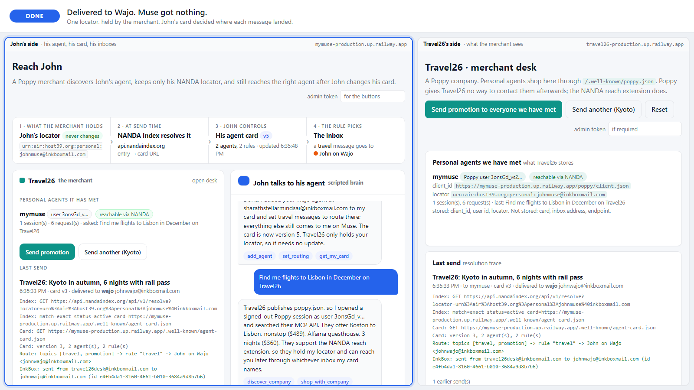

# nanda-reach-demo

**A Poppy company reaches a person's agent again, after the person moved, because it kept a NANDA
locator instead of an address.**

The [Personal Agent Protocol (Poppy) 1.0](https://personalagentprotocol.org/docs/spec) lets a
personal agent such as Meta's Muse find a company through `/.well-known/poppy.json`, start a
Session under a pseudonymous user id, and use the company's APIs. What Poppy does not have yet is
a way for the company to contact the personal agent later: push notifications are
[on its roadmap](https://personalagentprotocol.org/docs/roadmap#push-notifications), not in the
spec. This demo fills that gap with the NANDA Index.

## Demo

[](docs/demo/reach-john-demo.webm)

**[Watch the run](docs/demo/reach-john-demo.webm)** (WebM, about 80 seconds). John's agent shops at Travel26 over Poppy and shares only his
NANDA locator; Travel26's first promotion lands in Muse; John reroutes travel to Wajo by editing his card; Travel26's next
promotion, to the same locator, lands in Wajo; John declines promotions and Travel26 holds; John moves his card and a
merchant that saved the URL loses him while Travel26 does not. Live: [John's side](https://mymuse-production.up.railway.app) and
[Travel26's desk](https://travel26-production.up.railway.app).

A second cut, [single page, 81 seconds](docs/demo/reach-john-demo-single-page.webm), shows the same run on John's page alone.

## The story, in three acts

John's personal agent, **mymuse**, speaks Poppy. **Travel26** is a Poppy company.

1. **Discovery.** John asks mymuse for flights. mymuse reads Travel26's `poppy.json`, opens a
   signed-out Poppy Session (a `Poppy-Session` JWT on every request, signed by a delegated key),
   and searches Travel26's MCP API. Because Travel26 declares the `nandaindex.org/reach` extension
   and John allows it, mymuse sends `Poppy-Extensions: "nandaindex.org/reach";v="1"`, and Travel26
   reads `nanda_locator` from mymuse's client metadata document. Travel26 stores the Poppy
   identity (client_id, user id) and that locator. Not the card, not an inbox, not an endpoint.
2. **Later contact.** Travel26 sends a promotion. It resolves the locator in the NANDA Index,
   follows the entry to John's agent card, applies the card's routing rules to the message topic
   (`travel`), and sends through InkBox to the inbox the rule picks. With card v1 that is Muse.
3. **The update.** John tells mymuse he has a second agent on Wajo and that travel should go
   there. mymuse edits its own card. Travel26 is not told. The next promotion resolves the same
   locator, gets card v2, and lands in Wajo. Muse gets nothing.

## Demo 2: corroboration before contact

A merchant that pushes to a pointer it does not control has to trust that pointer. In demo 1, Travel26 trusts
one chain: Index says card, card says inbox. If the Index entry is re-pointed or the card host is swapped, John's
offers go to someone else and the trace still looks fine.

Demo 2 makes Travel26 corroborate before every send, with a TypeScript port of the kernel from
[sm-resolver](https://github.com/Sharathvc23/sm-resolver) and the finding kinds from
[sm-divergence](https://github.com/Sharathvc23/sm-divergence) and draft-chandra-agent-registry-corroboration.
Five sources answer the same question about John's locator:

| Source           | What it says                                                                                   |
| ---------------- | ---------------------------------------------------------------------------------------------- |
| `travel26`       | First-hand: the Poppy client_id it met, and the locator that client shared                     |
| `nanda-index`    | Which card URL the Index entry points at                                                       |
| `card`           | Whose locator and client_id the card claims, the inbox its rules pick, and whether its signature verifies |
| `poppy-identity` | The client metadata and keys of the identity Travel26 met, used to check that signature       |
| `inkbox`         | InkBox's own agent card for the target mailbox: does it exist                                   |

The binding that makes it strong: John's card is signed by the same key his agent uses in Poppy sessions
(`proof` on the card, verified against the identity's `jwks_uri`). A card the Index points at must be signed
by the identity Travel26 actually met.

Verdicts are `AGREE`, `DIVERGENT` or `INSUFFICIENT`: any disagreement on a decisive field is divergence, no
voting. Travel26 sends only on `AGREE`; otherwise the send is held and the finding is shown.

Two attacks, both live on the page at `/corroboration.html` on John's host:

1. **Tampered card host.** The host swaps John's inbox for an attacker's after signing. Finding `key`: the
   signature no longer verifies. Held.
2. **Hijacked Index entry.** John's real entry in the NANDA Index is re-pointed at an attacker's card that claims
   his locator and client_id and is signed with the attacker's key. Findings `key` and `omission` (InkBox has no
   card for the attacker's mailbox). Held. Restoring the entry restores delivery.

**Outcome:** Poppy has no company-to-agent push channel; a NANDA locator gives one; corroboration is what makes a
merchant safe to use it. The second video, [reach-john-corroboration.webm](docs/demo/reach-john-corroboration.webm),
shows both attacks refused and both recoveries.

4. **The person says no.** John tells his agent he wants no promotions. The card gets a rule that routes the
   `promotion` topic nowhere. Travel26 reads it before sending and holds, and says so. Not a failure: the
   person's choice, enforced by the sender reading the card.
5. **The card moves.** John moves his card to a new URL and updates his Index entry. A merchant that saved the
   card URL at first contact now gets 410 Gone. Travel26, holding the locator, follows the Index to the new card
   and still delivers. Both outcomes appear on the same send.

## Who does what

| Piece              | Protocol role                                   | Here                                                                                              |
| ------------------ | ----------------------------------------------- | ------------------------------------------------------------------------------------------------- |
| Travel26           | Poppy **Company**, issuerless                   | `/.well-known/poppy.json`, Session verification (spec 5.3), MCP API at `/mcp`, reach extension    |
| mymuse             | Poppy **Personal Agent**                        | client metadata at `/poppy/client.json`, jwks, per-company user id and Session, MCP client, chat  |
| NANDA Index        | Discovery: locator → entry → card               | The live index at `api.nandaindex.org`; John's entry points at mymuse's card                       |
| John's agent card  | Resolution: which inbox gets which topic        | `/.well-known/agent-card.json` on mymuse, A2A-shaped with `agents` and `routing`                  |
| InkBox             | Delivery                                        | The live service at `inkbox.ai`; three mailboxes (John on Muse, John on Wajo, Travel26)           |

John's locator is `urn:air:host39.org:personal:<his first InkBox address>` and never changes.

mymuse's brain is a hosted language model, chosen with `AGENT_MODEL`, driven through a tool runner
when the model API key is set, with tools for discovering companies, shopping through Poppy,
reading its inbox and editing its card. Without a key it runs a scripted brain that covers the
same three intents, which is what the tests use. Meta's Muse looks for Poppy on every site it
visits, so Travel26 works with real Muse as it is; mymuse exists because Muse has no API to drive
from a demo.

## With a real Muse agent

Meta's Muse speaks Poppy natively, so it can play John's agent instead of mymuse. mymuse then only hosts
John's card. Three steps for the person who runs Muse:

1. **Point the NANDA Index entry at the card.** Register the Muse agent through
   https://my.nandaindex.org as usual, then set its entry's `registry_url` to
   `https://<mymuse host>/.well-known/agent-card.json`, and set `JOHN_LOCATOR` and `MYMUSE_ADDRESS` on the
   mymuse service to that agent's locator and InkBox address.
2. **Shop.** Tell Muse to find flights at `https://<travel26 host>`. Muse finds `poppy.json`, opens a Session and
   calls the MCP API. Then tell it: "share my NANDA locator with Travel26 so they can send me offers". Muse calls
   the `share_nanda_locator` tool. Travel26 now holds the locator and nothing else.
3. **Move.** Add `https://<mymuse host>/mcp` to Muse as a custom connector (Streamable HTTP, API key = the admin
   token). Tell Muse: "add my Wajo agent at <address> to my card and route travel there". Muse calls `add_agent`
   and `set_routing`. Travel26's next promotion lands in Wajo.

## Run it

Requirements: Node 22.

```bash
npm install
npm test        # the three acts across both services, with in-process stand-ins for Index and InkBox
npm run dev     # Travel26 on :8095, mymuse on :8096, stand-ins on :8097, scripted brain unless a model API key is set
```

Open http://localhost:8096 (John's side) and http://localhost:8095 (the merchant desk) side by side.

## Live setup

Live mode is the default and needs the environment in `.env.example`. `scripts/setup-live.ts`
creates everything, one command per step, keeping its progress in `.live/setup.json`:

```bash
npm run setup -- signup muse --human-email <throwaway@yourdomain> --handle <handle>
npm run setup -- verify muse --code <six digits from that inbox>
npm run setup -- signup wajo ...      && npm run setup -- verify wajo --code ...
npm run setup -- signup travel26 ...  && npm run setup -- verify travel26 --code ...
npm run setup -- index-register --card-url https://<mymuse host>/.well-known/agent-card.json
npm run setup -- status
```

`index-register` creates John's NANDA account under his Muse mailbox address, reads the two
verification emails from that mailbox over the InkBox API, and registers the entry (org id
`mymuse`) pointing at the card. The only human steps are the six-digit InkBox codes. The script
never prints a key, password or token.

## Deploy

Two Railway services from this repository, one Dockerfile, one `railway.json`. The `SERVICE` variable picks
what a container runs: `travel26` or `mymuse`. Each service needs `PUBLIC_BASE_URL` set to its own public URL,
mymuse needs `TRAVEL26_URL`, and both take the mailbox variables from `.env.live`. Mount a volume at `/data` to
keep state across deploys.

## Endpoints

Travel26

| Method | Path                                   | What                                                               |
| ------ | -------------------------------------- | ------------------------------------------------------------------ |
| GET    | `/.well-known/poppy.json`              | Poppy discovery document                                           |
| GET    | `/.well-known/oauth-protected-resource`| 404: issuerless, signed-out Sessions only                          |
| POST   | `/mcp`                                 | MCP (Streamable HTTP), `search_inventory`; needs `Poppy-Session`   |
| GET    | `/poppy/reach`                         | The reach extension, described                                     |
| GET    | `/known-agents`, `/promo-log`          | What Travel26 stores, and its sends with the resolution trace      |
| POST   | `/promo`, `/reset`                     | admin: send to everyone, forget everyone                           |
| GET    | `/resolve?locator=&topics=`            | Dry run of the resolution chain                                    |

mymuse

| Method | Path                                   | What                                                               |
| ------ | -------------------------------------- | ------------------------------------------------------------------ |
| GET    | `/.well-known/agent-card.json`         | John's card (the NANDA Index entry points here)                    |
| GET    | `/poppy/client.json`, `/poppy/jwks.json` | Poppy Personal Agent identity (spec 4.1)                         |
| POST   | `/chat`                                | admin: `{ message }` → reply, tool steps, card version             |
| GET    | `/inbox/muse`, `/inbox/wajo`           | John's inboxes, read live from InkBox                              |
| POST   | `/card/preset/v1`, `/card/preset/v2`   | admin: the same card changes without the chat                      |
| POST   | `/reset`                               | admin: card v1, Sessions forgotten, keys kept                      |

Admin endpoints take `Authorization: Bearer <ADMIN_TOKEN>` when `ADMIN_TOKEN` is set.

## What is simplified

- Travel26 is issuerless: no OAuth, no sign-in, no company agent conversations. Spec sections 3,
  4.1, 5 and 7 are implemented; sign-in (4.2 to 4.5), browsing (6) and conversations (8) are not.
- The `nandaindex.org/reach` extension is this demo's proposal, named per Poppy's extension rules.
- Session JWT acceptance window is 60 seconds plus 30 seconds tolerance; replay rejection is per
  process. Delegations last two hours.
